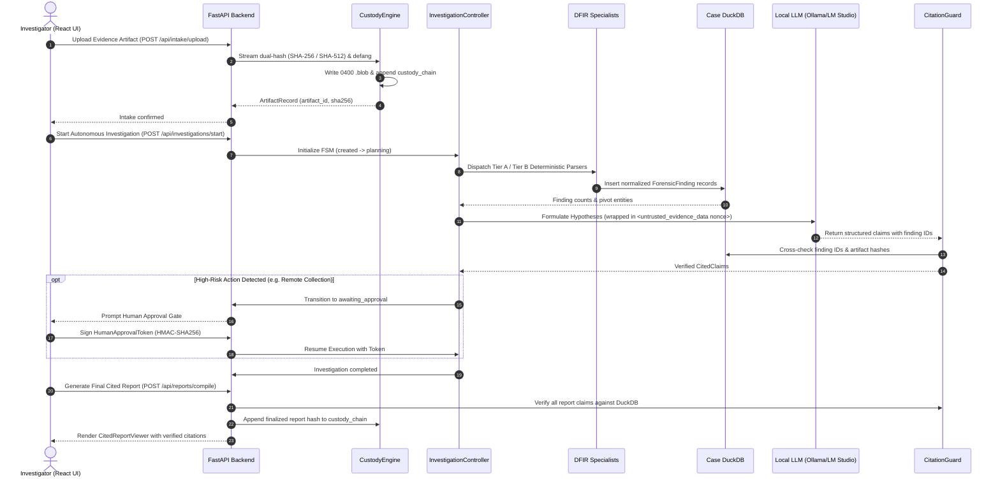

# ForensicOps AI — Repository & Module Decomposition Map (`REPOSITORY_MAP.md`)

**Document Reference:** `docs/architecture/REPOSITORY_MAP.md`  
**Current Status:** Phase 0 Baseline Documentation  
**Date:** 2026-11-16  
**Auditor / Engineering Swarm:** ForensicOps AI Core Engineering Swarm (@analyst, @architect, @forensics, @security, @qa, @docs)  
**System Version:** ForensicOps AI v1.2 (Post-Phase 11 Acceptance)  

---

## 1. Top-Level Repository Directory Layout

The repository is structured into distinct operational tiers separating backend API and orchestration, frontend user experience, triage collectors, declarative tool plugins, test suites, and forensic vault data.

```
c:\forensicops-ai\
├── .agents\                 # Antigravity agent configurations and custom skills
├── .antigravity\            # Antigravity IDE rules and metadata
├── audits\                  # Security audit reports, benchmark results, and PoC test scripts
├── backend\                 # Core Python backend application and test suite
│   ├── app\                 # FastAPI application source code
│   │   ├── agent\           # Autonomous controller, LangGraph engine, LLM clients, blueprints
│   │   ├── api\             # REST and SSE API endpoint routers
│   │   ├── auth\            # RBAC authentication, JWT security, user store
│   │   ├── connectors\      # Read-only SIEM connectors and remote collector orchestrator
│   │   ├── core\            # Custody engine, storage, Dissect parser, plugin runner, policies
│   │   ├── db\              # SQLite database access layer
│   │   ├── models\          # Pydantic v2 data models, immutable findings, and schemas
│   │   └── specialists\     # 6 Modular DFIR domain specialist engines
│   └── tests\               # Pytest suite (305 unit, integration, and acceptance tests)
├── collectors\              # Endpoint live-triage scripts (PowerShell and Bash)
├── frontend\                # React 19 / TypeScript / Vite single-page application
│   ├── src\
│   │   ├── assets\          # Static images and icons
│   │   ├── components\      # React UI views, modals, drawers, and workflow nodes
│   │   ├── context\         # Authentication and investigation React contexts
│   │   ├── services\        # HTTP and SSE client service layer
│   │   ├── store\           # Zustand global state store
│   │   └── types\           # TypeScript data interfaces and type contracts
│   └── dist\                # Compiled production web assets
├── plugins\                 # Declarative YAML tool adapter cards (Chainsaw, EZ-Tools, Volatility, YARA)
├── sample\                  # Representative forensic evidence samples (EVTX, PCAP, Memory, ETL)
├── specs\                   # Project specifications (01-Overview through 05-Master-Execution-Plan)
├── vault\                   # Local forensic storage (blobs, SQLite DBs, DuckDB per-case instances)
├── AGENTS.md                # Permanent engineering contract and forensic architecture principles
├── STATUS.md                # Living status tracker and historical phase completion log
└── pyproject.toml           # Python build configuration, dependencies, and tool settings
```

---

## 2. Backend Architecture & Module Directory (`backend/app/`)

### 2.1 Core Subsystems (`backend/app/core/`)

| File | Purpose & Architectural Responsibility | Key Interfaces & Classes |
| :--- | :--- | :--- |
| `custody_engine.py` | RFC 3227 append-only hash-chained ledger, streaming dual-hash (SHA-256/512) computation, defanged `.blob` storage (`0400` read-only), and streaming `ZipGuard` path traversal protection. | `CustodyEngine`, `ZipGuard`, `safe_make_readonly`, `verify_chain_integrity` |
| `storage.py` | Dual forensic storage manager: provides isolated per-case DuckDB analytical query sessions and SQLite operational state management. | `ForensicStore`, `get_case_duckdb_path` |
| `dissect_adapter.py` | Built-in userspace flat evidence reader: parses EVTX event streams (`python-evtx`), MBR/GPT partition tables, and Linux logs without host kernel mounting. Explicitly rejects proprietary E01/VMDK containers. | `DissectAdapter`, `parse_evtx`, `parse_registry_hive`, `parse_disk_image_stream` |
| `plugin_runner.py` | Sandboxed external forensic tool execution engine: runs containerized OCI images or subprocesses enforcing `shell=False`, `--network=none`, and `--read-only` mounts. | `PluginRunner`, `run_plugin`, `_build_command` |
| `execution_policy.py` | Deterministic execution policies declaring tool allowlists, memory/CPU quotas, execution timeouts, and disallowed argument patterns. | `ExecutionPolicyRegistry`, `ToolExecutionPolicy`, `APPROVED_POLICIES` |
| `action_risk_policy.py` | Action risk classification engine categorizing operations into `READ_ONLY`, `LOW_RISK_MUTATION`, `HIGH_RISK_SENSITIVE`, and `CRITICAL_MUTATION`. | `ActionRiskPolicy`, `RiskTier`, `evaluate_action_risk` |
| `approval_engine.py` | Human-in-the-loop authorization engine managing the creation, HMAC-SHA256 signing, expiration, replay prevention, and consumption of `HumanApprovalToken`. | `ApprovalEngine`, `HumanApprovalToken`, `ApprovalRequest` |
| `citation_guard.py` | Deterministic citation post-validator: cross-references LLM claims against DuckDB finding IDs and source artifact hashes, stripping or rejecting ungrounded claims. | `CitationGuard`, `validate_citations`, `CitationValidationError` |
| `column_projector.py` | Dynamic column projection engine: filters noisy forensic tool output columns down to high-signal `ai_keep_fields` while recording compression in `audit.jsonl`. | `ColumnProjector`, `project_columns` |
| `artifact_indexer.py` | Inspects ingested artifacts, identifies target OS and evidence categories, and flags missing dependencies as `SKIPPED_NO_ARTIFACT`. | `ArtifactIndexer`, `index_artifacts` |
| `playbook_registry.py` | Complete 14-tactic MITRE ATT&CK Enterprise playbook registry (`TA0001` - `TA0043`) mapping tactics to artifact globs, tool parsers, and scoped filter parameters. | `PlaybookRegistry`, `MITRETacticPlaybook` |
| `specialist_registry.py`| Central discovery and capability dispatch registry for the 6 DFIR domain specialist engines. | `SpecialistRegistry`, `register_specialist`, `get_specialist` |
| `analyzer_registry.py`  | Registry coordinating built-in pure-Python parsers (Tier A) and external plugin runners (Tier B). | `AnalyzerRegistry`, `get_analyzer` |
| `auto_mapper.py`        | Normalization engine transforming diverse raw parser outputs into standard `ForensicFinding` records. | `AutoMapper`, `map_raw_to_findings` |
| `network_validator.py`  | SSRF prevention engine enforcing loopback blocking, link-local metadata protection, target allowlists, pre-flight DNS resolution, and credential scrubbing. | `NetworkValidator`, `validate_url_ssrf`, `sanitize_credentials` |
| `config.py`             | Centralized Pydantic Settings (`AppConfig`): enforces loopback binding (`127.0.0.1`) by default, validates production secrets, and manages filesystem paths. | `AppConfig`, `get_settings`, `validate_production_configuration` |
| `logging_config.py`     | Production structured JSON logging featuring `SecretRedactingFilter` to scrub API keys, passwords, and Bearer tokens. | `setup_structured_logging`, `SecretRedactingFilter` |
| `maintenance.py`        | Database maintenance utilities: online crash-consistent SQLite backup (`conn.backup()`), SHA-256 backup verification, and staging retention cleanup. | `backup_database`, `verify_and_restore_backup`, `cleanup_temporary_staging` |
| `exceptions.py`         | Centralized domain exception hierarchy preserving diagnostic context. | `ForensicOpsError`, `CustodyTamperError`, `SecurityBoundaryError`, `CitationValidationError` |

### 2.2 Agent, Controller & Orchestration (`backend/app/agent/`)

| File | Purpose & Architectural Responsibility | Key Interfaces & Classes |
| :--- | :--- | :--- |
| `investigation_controller.py` | Autonomous investigation controller driving an iterative lifecycle state machine, enforcing execution budgets, testing competing hypotheses, cataloging evidence gaps, and pausing for human approvals. | `InvestigationController`, `InvestigationRecord`, `InvestigationState`, `execute_investigation_iteration` |
| `graph.py` | LangGraph DAG workflow engine executing analyst-directed forensic pipelines. Passes lightweight `WorkflowEdgePayload` references and streams node states over SSE. | `compile_forensic_graph`, `WorkflowExecutionState`, `WorkflowEdgePayload` |
| `hypothesis_planner.py` | Deterministic hypothesis generation engine inferring likely MITRE ATT&CK playbooks from evidence metadata and generating paired competing hypotheses. | `HypothesisPlanner`, `DeterministicGoalPlan`, `infer_blueprints` |
| `provider_registry.py` | Multi-provider LLM registry abstracting local (Ollama, LM Studio) and cloud (NVIDIA NIM, OpenRouter, Gemini) backends. | `ProviderRegistry`, `get_llm_provider`, `smoke_test_provider` |
| `ollama_client.py` | HTTP client for local Ollama instances enforcing JSON Schema structured output. | `OllamaClient`, `generate_structured_output` |
| `lmstudio_client.py` | HTTP client for local LM Studio instances with OpenAI-compatible endpoint formatting. | `LMStudioClient`, `generate_structured_output` |
| `prompts.py` | Central prompt templates and anti-IPI isolation boundaries wrapping evidence in cryptographic nonce tags (`<untrusted_evidence_data nonce="...">`). | `COPILOT_SYSTEM_PROMPT`, `wrap_untrusted_evidence` |
| `report_builder.py` | RFC 3227 cited forensic report compiler implementing AIFT's 4-Part Rubric (*Why It Matters*, *Benign Alternative*, *Verification Steps*, *Data Gaps*) and Patient Zero correlation. | `ReportBuilder`, `compile_cited_report`, `AIFTRubric` |
| `tools.py` | Deterministic tool implementations for DuckDB analytical queries, scoped timeline filtering, native PCAP packet parsing, and Linux auth log analysis. | `query_duckdb_findings`, `apply_scoped_filters`, `parse_pcap_file`, `parse_linux_text_log` |
| `blueprints.py` | Pre-configured LangGraph workflow templates (Windows Intrusion, Full Windows Triage, Linux SSH Compromise, Memory+PCAP Hunt). | `STARTER_BLUEPRINTS`, `get_blueprint_by_id` |
| `memory_protocol.py` | Working memory and analyst feedback persistence protocol backed by SQLite. | `KnowledgeAndMemoryProvider`, `SQLiteFeedbackMemoryProvider` |

### 2.3 Modular DFIR Specialists (`backend/app/specialists/`)

| Specialist File | Domain & Capability Coverage | Key Artifacts & Tools Handled |
| :--- | :--- | :--- |
| `windows_dfir.py` | Windows event logs, registry analysis, authentication anomalies, service installations, and persistence mechanisms. | Security, System, and Sysmon EVTX, Registry hives, Chainsaw Sigma rules, EvtxECmd, RECmd. |
| `linux_dfir.py` | Linux authentication logs, sudo command abuse, cron persistence, SSH brute-force tracking, and systemd service changes. | `auth.log`, `secure`, `syslog`, `/etc/cron*`, interactive shell history. |
| `memory_forensics.py` | Windows memory triage: active and unlinked process execution, parent-child hierarchies, hidden injected modules. | Raw memory dumps (`.raw`, `.dmp`, `.vmem`), Volatility 3 `windows.pslist`. |
| `network_forensics.py` | Network packet triage: IPv4 Ethernet frames, TCP/UDP conversations, RAT port detection (TeamViewer), and statistical beaconing analysis. | Raw `.pcap` capture files, native IP frame decoder, statistical interval analyzer. |
| `malware_analysis.py` | Static portable executable (PE) inspection: header parsing, section hashing, suspicious import detection, and embedded string analysis. | Windows PE binaries (`.exe`, `.dll`), regex string scanner, YARA signature scanner. |
| `timeline_correlation.py`| Cross-host and cross-artifact timeline synthesis, multi-source event sequencing, and Patient Zero identification. | Normalized DuckDB findings table, UTC timestamp indexer, host pivot correlator. |

### 2.4 Authentication, Connectors & API Routers

- **Authentication & RBAC (`backend/app/auth/`):**
  - `models.py`: Pydantic user models, role definitions (`lead_investigator`, `soc_analyst`, `auditor`).
  - `security.py`: Direct `bcrypt` password hashing and `python-jose` HS256 JWT access token creation/validation.
  - `store.py`: SQLite user database (`vault/users.db`) managing investigator accounts and activation states.
  - `dependencies.py`: Dependency guards `get_current_user` and `require_roles(*roles)`.
- **Connectors (`backend/app/connectors/`):**
  - `siem_connectors.py`: Read-only connectors for Elasticsearch, Wazuh, and Splunk normalizing events into `ForensicFinding` records with query snapshot hashes.
  - `ssh_collector.py`: Remote live-triage acquisition orchestrator deploying approved triage scripts over SSH/WinRM after verifying a signed `HumanApprovalToken`.
- **API Endpoint Routers (`backend/app/api/`):**
  - `auth.py`: Setup, login, user management, and current profile (`/api/auth/*`).
  - `cases.py`: Case lifecycle CRUD, case scoping, and status tracking (`/api/cases/*`).
  - `intake.py`: Evidence ingestion: file uploads, defanged vaulting, and zero-copy path registration (`/api/intake/*`).
  - `investigations.py`: Autonomous investigation controller management, step iterations, and approval resumes (`/api/investigations/*`).
  - `workflows.py`: LangGraph DAG compilation, execution, and real-time SSE event streaming (`/api/workflows/*`).
  - `findings.py`: DuckDB forensic findings querying, filtering, and timeline exports (`/api/findings/*`).
  - `reports.py`: RFC 3227 cited report compilation, cryptographic signing, and verification (`/api/reports/*`).
  - `copilot.py`: Interactive DFIR copilot chat with mandatory citation enforcement (`/api/copilot/*`).
  - `plugins.py`: Declarative plugin manifest discovery and dry-run execution (`/api/plugins/*`).
  - `llm.py`: Provider configuration, active model selection, and connectivity smoke tests (`/api/llm/*`).
  - `session.py`: Active case session state management (`/api/session/*`).
  - `feedback.py`: Analyst confirmation and feedback recording for RAG learning (`/api/feedback/*`).
  - `deps.py`: Shared FastAPI dependency injection providers.

---

## 3. Frontend Architecture & Component Decomposition (`frontend/src/`)

The frontend is a React 19 single-page application built with TypeScript, Tailwind CSS, and React Flow.

### 3.1 Primary Views & Workspaces

```
frontend/src/components/
├── AuthGate.tsx                 # First-boot setup and investigator login with Badge ID / Username
├── Navbar.tsx                   # Top navigation bar: identity chip, role badge, case selector, sign-out
├── EnvironmentWizard.tsx        # 4-Step intake wizard: case setup, evidence upload, tool configuration, initial plan
├── InvestigationView.tsx        # Autonomous investigation controller dashboard: FSM state, specialists, budgets, gaps, approvals
├── WorkflowCanvas.tsx           # Interactive React Flow DAG canvas: visual node editing, status animations, execution controls
├── CaseManagerView.tsx          # Comprehensive case management: status, priority, and assigned investigators
├── CaseVaultView.tsx            # Case evidence explorer: blob hashes, custody verification status, file details
├── CitedReportViewer.tsx        # 6-Section cited report viewer with clickable SHA-256 finding citation drawers
├── CustodyLedgerModal.tsx       # Real-time RFC 3227 hash-chained custody ledger inspection modal
├── PluginManagerModal.tsx       # YAML tool plugin inspector and dry-run execution interface
├── ApprovalReviewModal.tsx      # Cryptographic human authorization modal: review target, action, digest, and sign
├── ForensicCopilotDrawer.tsx    # Slide-over interactive DFIR copilot with cited claim verification
├── ForensicNode.tsx             # Custom React Flow node rendering status badges, execution times, and finding counts
├── PivotEdge.tsx                # Custom React Flow edge visualizing entity pivot data transfers
└── UserManagementModal.tsx      # Lead investigator modal for creating and managing investigator accounts
```

### 3.2 State, Services & Security

- **`frontend/src/context/AuthContext.tsx`:** Manages investigator session state. Enforces ephemeral `sessionStorage` token retention and purges `localStorage` on login, logout, and token refresh.
- **`frontend/src/context/InvestigationContext.tsx`:** Manages active case scope, wizard progress, and evidence staging.
- **`frontend/src/services/api.ts`:** Axios/fetch wrapper with JWT authorization headers, automatic error handling, and SSE subscription utilities.
- **`frontend/src/store/useForensicStore.ts`:** Zustand store managing active workflow DAG state, selected nodes, and timeline filters.
- **`frontend/src/types/`:** Strong TypeScript interfaces defining auth models (`auth.ts`) and forensic entities (`index.ts`).

---

## 4. Collectors & Declarative Plugin Adapters

### 4.1 Triage Collectors (`collectors/`)
- **`collectors/windows/Invoke-ForensicCollector.ps1`:** Non-destructive PowerShell triage script collecting Security/System/Sysmon EVTX, active network sockets, running processes, Autoruns, and triage registry hives. Packages outputs into a ZIP capsule with cryptographic `manifest.json`.
- **`collectors/linux/collect_linux_triage.sh`:** Air-gapped Bash script collecting `/var/log/auth.log`, `syslog`, `ss -tupn`, `ps aux`, `crontab -l`, and systemd unit configurations into a validated triage archive.

### 4.2 Declarative Tool Plugins (`plugins/`)
- `chainsaw_sigma.yaml`: Rapid EVTX search and Sigma rule evaluation engine.
- `ez_evtxecmd.yaml`: Eric Zimmerman's EVTX parser extracting structured CSV/JSONL records.
- `ez_recmd.yaml`: Eric Zimmerman's Registry Command Line tool parsing binary hives.
- `volatility3_pslist.yaml`: Volatility 3 memory forensics adapter extracting process trees.
- `yara_scanner.yaml`: YARA signature scanning engine evaluating binary and file samples.

---

## 5. Runtime Execution & Data Flows



---

## 6. Dead & Redundant Code Register

During the Phase 0 audit, the following redundant, duplicate, or dead code items were identified:

| Item ID | Location | Nature of Redundancy / Dead Code | Recommended Resolution |
| :--- | :--- | :--- | :--- |
| **RED-01** | `backend/app/api/workflows.py:55-75` | Rogue `POST /api/workflows/approval-token` issues unconstrained approval tokens without passing through `ApprovalEngine`. | Deprecate and remove; route all token generation through `ApprovalEngine`. |
| **RED-02** | `backend/app/api/workflows.py` vs `backend/app/api/investigations.py` | Dual orchestration endpoints: `/api/workflows/*` executes static LangGraph DAGs while `/api/investigations/*` executes the autonomous controller. | Retain both but formally document their distinct roles (Analyst Playbook vs Autonomous Investigation). |
| **RED-03** | `backend/app/core/custody_engine.py` | `EXECUTABLE_EXTENSIONS` table exists in module scope but is not referenced during extraction defanging. | Clean up dead table or integrate directly into archive extraction defanging logic. |
| **RED-04** | Repository Root | Standalone benchmark and inspection scripts (`run_dfir_benchmark.py`, `evaluate_models.py`, `inspect_answers.py`) reside at the root. | Relocate into `backend/benchmarks/` or `tools/` with standardized runner wrappers. |
