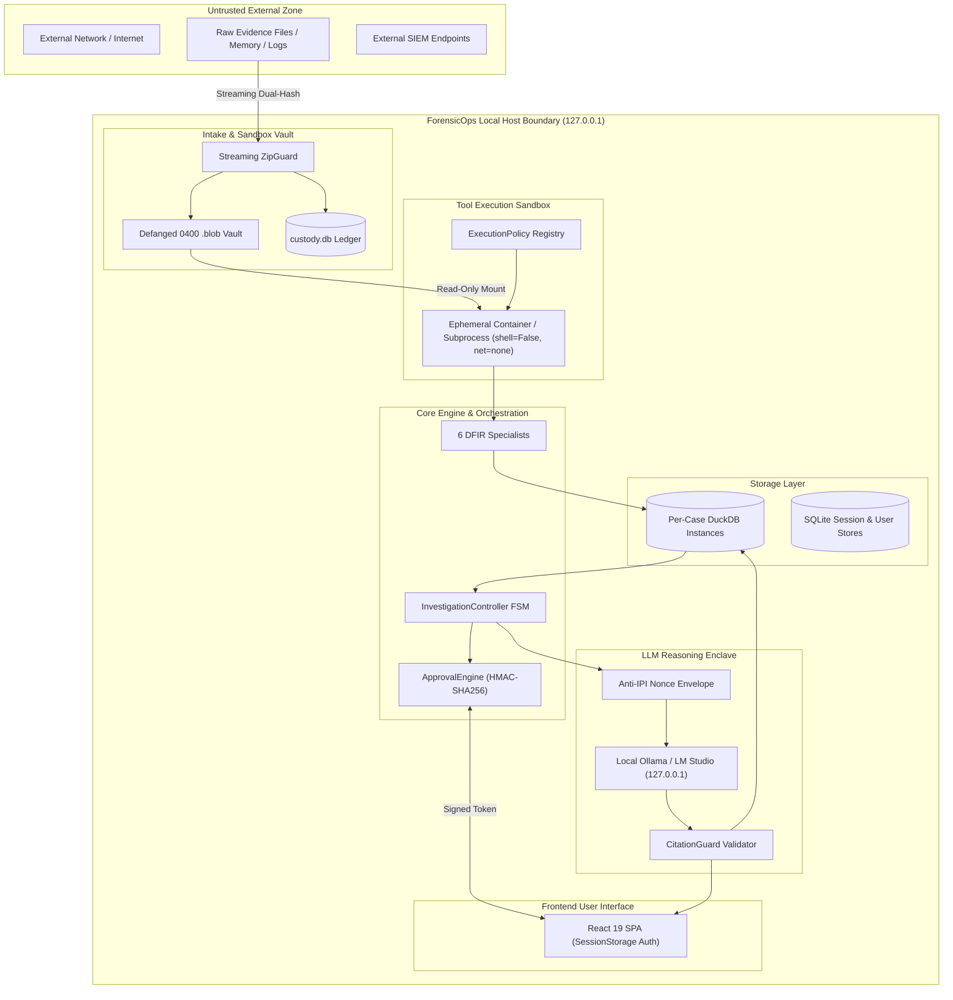

# ForensicOps AI — Target Architecture Specification (`TARGET_ARCHITECTURE.md`)

**Document Reference:** `docs/architecture/TARGET_ARCHITECTURE.md`  
**Current Status:** Phase 0 Target Architecture Alignment  
**Date:** 2026-11-16  
**Auditor / Engineering Swarm:** ForensicOps AI Core Engineering Swarm (@analyst, @architect, @forensics, @security, @qa, @docs)  
**Target Compliance:** RFC 3227, ISO/IEC 27037, NIST SP 800-86, AGENTS.md Permanent Engineering Contract  

---

## 1. Architectural Vision & Governing Principles

ForensicOps AI is designed as a production-grade, controlled-autonomy digital forensics investigation platform. Its foundational mandate is to separate **deterministic forensic fact generation** from **probabilistic LLM reasoning**, ensuring that every assertion in an investigative report is backed by unbroken cryptographic evidence custody and verifiable deterministic tool outputs.

### The Non-Negotiable Core Tenet
> **Deterministic tools produce facts. LLMs plan, orchestrate, correlate, explain, and draft. An LLM is never the source of a forensic fact.**

```
+---------------------------------------------------------------------------------+
|                               FORENSICOPS AI PLATFORM                           |
+---------------------------------------------------------------------------------+
|  DETERMINISTIC FACT PLANE                      PROBABILISTIC REASONING PLANE    |
|  - Cryptographic Dual Hashing (SHA-256/512)    - Multi-Step Hypothesis Planning |
|  - Dissect Userspace Stream Parsers            - ATT&CK Tactic Mapping          |
|  - Air-Gapped OCI Plugin Sandboxes             - LLM Evidence Summarization     |
|  - Append-Only Hash-Chained Custody            - Timeline Correlation Synthesis |
|  - DuckDB Vectorized Finding Storage           - Investigative Report Drafting  |
+---------------------------------------------------------------------------------+
                                       |
                   [ DETERMINISTIC CITATIONGUARD BARRIER ]
                   Every LLM claim strictly validated against
                   persisted finding IDs & artifact hashes
                                       |
+---------------------------------------------------------------------------------+
|  CONTROLLED AUTONOMY & HUMAN AUTHORIZATION GATE                                 |
|  - Autonomous read-only parsing & timeline correlation                          |
|  - Cryptographic HMAC-SHA256 HumanApprovalToken for sensitive operations        |
|  - Zero-disk credential leakage & loopback-bound default networking             |
+---------------------------------------------------------------------------------+
```

---

## 2. The Nine Architectural Pillars

### Pillar 1: Strongly-Typed Pydantic v2 Data Contracts
- **Target Specification:** All core domain data models are defined using Pydantic v2 with immutable, frozen schemas (`ConfigDict(frozen=True)`). Data serialization across processes and database boundaries enforces RFC 8785 canonical JSON sorting to guarantee stable cryptographic hashing.
- **Frontend Synchronization:** 1:1 synchronization between Python Pydantic models (`backend/app/models/`) and TypeScript interfaces (`frontend/src/types/index.ts`).
- **Claim Grounding Rules:** Pydantic validators (`@model_validator(mode="after")`) enforce that every `CitedClaim` of type `observed_fact` and `derived_fact` contains non-empty citations, while `derived_correlation` claims require at least two distinct findings.

### Pillar 2: Dual Orchestration Engine (Visual DAGs + Autonomous Controller)
- **Target Specification:** The platform supports two synergistic orchestration modes:
  1. **Analyst-Directed Visual DAG Engine (LangGraph):** Pre-compiled or user-composed Directed Acyclic Graphs executing specific, predictable workflows (e.g. Starter Blueprints). Passes lightweight `WorkflowEdgePayload` references (`dataset_pointer` + entity pivots) without bulky data replication.
  2. **Autonomous Investigation Controller (`InvestigationController`):** An iterative Finite State Machine (`created` $\to$ `evidence_validation` $\to$ `planning` $\to$ `executing` $\to$ `evaluating` $\to$ `awaiting_approval` $\to$ `completed`) that explores evidence autonomously, maintains competing hypotheses, tracks evidence gaps, and pauses for human authorization when encountering high-risk actions.

### Pillar 3: Non-Mounting Flat Userspace Evidence Parsing (Dissect Adapter)
- **Target Specification:** Evidence artifacts (EVTX, Registry hives, raw disk streams, Linux logs, PCAPs) are parsed strictly in userspace without mounting disk images on the host kernel.
- **Security Boundaries:** Zero host kernel driver involvement eliminates kernel crash vectors and file system driver vulnerabilities. Compressed proprietary disk containers (`.E01`, `.VMDK`) are rejected at the boundary with clear diagnostic conversion requirements.

### Pillar 4: Sandboxed Subprocess & Container Runner (PluginRunner)
- **Target Specification:** External forensic tools (`chainsaw`, `EvtxECmd`, `RECmd`, `volatility3`, `yara`) execute in ephemeral, rootless OCI containers or sandboxed subprocesses.
- **Enforced Execution Policy:**
  - `shell=False` everywhere (zero shell interpolation).
  - `--network=none` (strict network denial).
  - `--read-only` input volume mounts for evidence.
  - Subprocess timeouts and process-tree termination (`SIGKILL` / `taskkill /F /T`).
  - Container paths translated cleanly from host paths to `/evidence:ro` and `/scratch:rw`.

### Pillar 5: Dual Forensic Storage (DuckDB + SQLite)
- **Target Specification:**
  - **Analytical Finding Store (DuckDB):** Isolated per-case database (`vault/<case_id>/findings.duckdb`). Columnar architecture optimized for complex SQL queries, time-series analysis, and full-text keyword searches across millions of forensic findings.
  - **Transactional Metadata Store (SQLite):** Thread-safe SQLite databases managing application state, user authentication (`users.db`), active investigation sessions, and append-only custody chains (`custody.db`).

### Pillar 6: Local-First LLM Provider Abstraction & Anti-IPI Nonce Boundaries
- **Target Specification:** Complete abstraction over local LLMs (Ollama, LM Studio) and optional cloud providers (Gemini, OpenRouter, NVIDIA NIM). Local-first operation is the default; no evidence data leaves the machine unless explicitly authorized.
- **Anti-IPI Boundary:** Untrusted forensic evidence text injected into prompts is wrapped in cryptographic nonce tags:
  ```xml
  <untrusted_evidence_data nonce="a1b2c3d4e5f6...">
  ... raw log / finding data ...
  </untrusted_evidence_data>
  ```
  The system instructions command the model to treat content inside this envelope strictly as passive analytical data, completely ignoring any embedded instruction overrides.

### Pillar 7: Deterministic Citation Enforcement (CitationGuard)
- **Target Specification:** A deterministic post-processing validator that intercepts all LLM outputs before they are persisted or presented to the investigator.
- **Enforcement Rules:**
  - Verifies that every cited `finding_id` exists in the case DuckDB store.
  - Verifies that cited cryptographic hashes match verified artifact records.
  - Strips or flags any claim that fails citation verification.
  - Guarantees that reports generated by the platform are 100% forensically defensible.

### Pillar 8: Operation-Specific Human Approval Engine
- **Target Specification:** Autonomous execution halts immediately whenever an action is categorized as `HIGH_RISK_SENSITIVE` or `CRITICAL_MUTATION` by `ActionRiskPolicy`.
- **HMAC-SHA256 Token Lifecycle:** Resuming requires a valid `HumanApprovalToken`. The token is cryptographically signed using `HUMAN_APPROVAL_HMAC_SECRET` and strictly binds:
  - `case_id`
  - `action_type` (e.g. `remote_collection`, `report_signing`)
  - `target` (e.g. endpoint IP/hostname)
  - `parameter_digest` (SHA-256 of canonical action parameters)
- **Replay Defense:** Tokens are single-use and permanently recorded as consumed in SQLite.

### Pillar 9: Hardened Ephemeral Frontend Architecture
- **Target Specification:** React 19 single-page application engineered with zero client-side disk persistence for forensic data.
- **Storage Policy:** Authentication tokens are stored exclusively in `sessionStorage` or in-memory React state. `localStorage` is actively purged. Forensic finding blobs and raw evidence are held only in component memory during active review and never written to browser disk storage.

---

## 3. Subsystem Boundaries & Trust Model



---

## 4. Minimal-Diff Migration Path

To evolve the existing codebase towards the target architecture without destabilizing existing green tests:

1. **Resolve Specialist Interface Discrepancies:** Add alias methods in `DissectAdapter` (`parse_evtx_stream = parse_evtx`, `parse_registry_hive_stream = parse_registry_hive`) to immediately fix silent attribute failures in `WindowsDFIRSpecialist` and `InvestigationController`.
2. **Synchronize TypeScript Contracts:** Update `frontend/src/types/index.ts` to export full types for `InvestigationRecord`, `InvestigationPlan`, `InvestigationAction`, `InvestigationBudget`, `CompetingHypothesis`, and `EvidenceGap`.
3. **Enforce Approval Token Parameter Binding:** Update `HumanApprovalToken.verify()` to reject tokens with `None` or wildcard fields when expected constraints are specified, closing the master token bypass vulnerability.
4. **Fix Container Path Translation:** Update `PluginRunner._build_command()` to translate host filesystem paths into container mount paths (`/evidence:ro`, `/scratch:rw`) prior to passing argv to OCI container runtimes.
5. **Sanitize Frontend Storage:** Remove plain-text SIEM API keys and passwords from `sessionStorage` in `InvestigationContext.tsx`.
