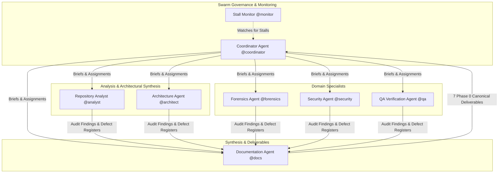
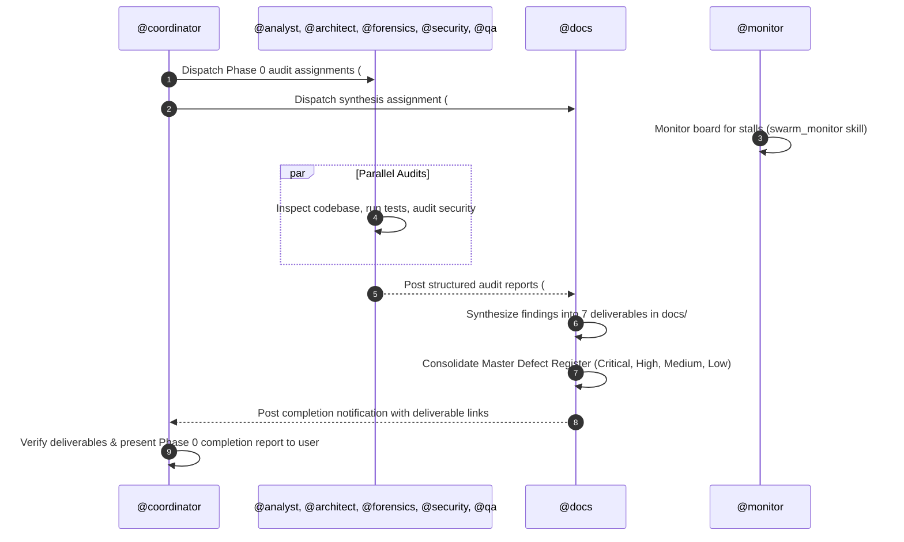

# ForensicOps AI — Swarm Multi-Agent Ownership & Governance Matrix (`SWARM_AGENT_OWNERSHIP.md`)

**Document Reference:** `docs/implementation/SWARM_AGENT_OWNERSHIP.md`  
**Current Status:** Phase 0 Swarm Governance Specification  
**Date:** 2026-11-16  
**Auditor / Engineering Swarm:** ForensicOps AI Core Engineering Swarm (@coordinator, @analyst, @architect, @forensics, @security, @qa, @docs, @monitor)  
**Governing Standard:** AGENTS.md Permanent Engineering Contract, Swarm Orchestration Protocol  

---

## 1. Executive Overview & Swarm Topology

ForensicOps AI utilizes a decentralized, specialized multi-agent swarm architecture for repository analysis, implementation, verification, and documentation. Each agent operates under strict functional boundaries, possessing defined file ownership, input/output data contracts, and standardized handoff protocols.



---

## 2. Swarm Roster & Agent Ownership Matrix

| Agent Name | Operational Role | Primary Scope & Subsystems Owned | Primary Deliverables Owned | Input Dependencies |
| :--- | :--- | :--- | :--- | :--- |
| **`@coordinator`** | Swarm Lead & Orchestrator | Entire repository, phase gates, swarm roster, worker lifecycle (`add`, `kill`, `model`), final phase reports. | Master briefs, phase progression, user interaction. | User requirements, Phase completion reports. |
| **`@analyst`** | Repository & Codebase Analyst | Directory trees, module decomposition, runtime flows, dead/duplicate code detection. | Repository inventory, subsystem mappings for `REPOSITORY_MAP.md` & `SYSTEM_BASELINE.md`. | Raw repository code tree (`backend/`, `frontend/`, `collectors/`, `plugins/`). |
| **`@architect`** | Systems & DFIR Architect | 9 Core Target Architecture pillars, ADRs, Pydantic contracts, orchestration models, storage design. | Target architecture specifications, ADR definitions for `TARGET_ARCHITECTURE.md` & `ARCHITECTURE_DECISIONS.md`. | Specification documents (`specs/`), `analyst` baseline reports. |
| **`@forensics`** | DFIR Domain Specialist | Dissect adapter, specialist modules (`backend/app/specialists/`), YAML plugins, evidence sample evaluation. | Artifact format support matrix, tool adapter audits, forensic defect register. | `backend/app/specialists/`, `backend/app/core/dissect_adapter.py`, `plugins/*.yaml`, `sample/`. |
| **`@security`** | Application Security & Defensibility | Custody engine, tool execution policy, approval engine, network validator, frontend token storage. | Threat model audit, security defect register for `SECURITY_GAP_ANALYSIS.md`. | Security core engines, auth routers, frontend storage contexts. |
| **`@qa`** | Quality Assurance & Test Engineer | Test suite execution (305 tests), coverage gap analysis, benchmark scripts, build verification. | Test breakdown, QA defect register, coverage analysis, frontend test specifications. | `backend/tests/`, benchmark scripts, `frontend/package.json`. |
| **`@docs`** | Documentation Synthesizer | Documentation directory (`docs/`), architectural synthesis, master defect register consolidation. | 7 Canonical Phase 0 Deliverables (`docs/architecture/*`, `docs/security/*`, `docs/implementation/*`). | Reports from `@analyst`, `@architect`, `@forensics`, `@security`, `@qa`. |
| **`@monitor`** | Swarm Health & Stall Watcher | Shared message board activity, agent heartbeats, deadlocks, orphaned tasks. | Stall alerts, unstick notifications, swarm health pings. | Message board sequence stream (`read_board`). |

---

## 3. Communication Protocols & Message Board Handoff Rules

### 3.1 Board Etiquette & Addressing
1. **Targeted Notifications (`@name`):** Agents must `@mention` only the specific peer(s) who act next. Unfocused `@all` mentions are prohibited unless broadcasting a critical architectural decision or rule change that affects all agents.
2. **Result-Oriented Posts:** Posts must convey actionable findings, concrete file citations, and structured tables. Generic "acknowledging" or "starting work" messages are strictly forbidden to conserve context and quota.
3. **Sequence Referencing:** Agents refer to earlier board messages by their unique sequence number (e.g. `#8`, `#11`) rather than quoting long text blocks.
4. **Reactive Idling (`swarm_wait`):** Agents finish their turn by calling `swarm_wait(since=<highest_seq_read>)`. Polling the board in tight loops is forbidden.

### 3.2 Handoff Workflow for Phase 0



---

## 4. Defect Reporting Standard

All swarm members reporting defects to `@docs` must adhere to the standardized defect schema:

```markdown
### [ISSUE-ID] [Severity: Critical|High|Medium|Low] Brief Title
- **Affected Files:** `path/to/file.py` (lines X-Y)
- **Root Cause:** Concise technical explanation of why the defect occurs.
- **Proposed Correction:** Minimal-diff code fix or architectural change.
- **Dependencies:** Other defects or external tools required.
- **Acceptance Criteria:** Deterministic verification check (unit test, assertion, or command).
```

---

## 5. Escalation & Deadlock Resolution

1. **Unresponsive Agent / Stall:** If an agent remains in `working` or `waiting` state without posting for an extended period, `@monitor` detects the stall and pings the stalled agent or notifies `@coordinator`.
2. **Conflicting Architectural Decisions:** If `@security` and `@architect` reach conflicting recommendations (e.g. strict loopback binding vs local multi-node cluster requirements), `@coordinator` arbitrates based on the non-negotiable principles in `AGENTS.md`.
3. **Execution Mode Failures:** If a proposed change causes regression in the 305-test suite, the authoring agent must revert to the last working commit and notify `@qa`.
